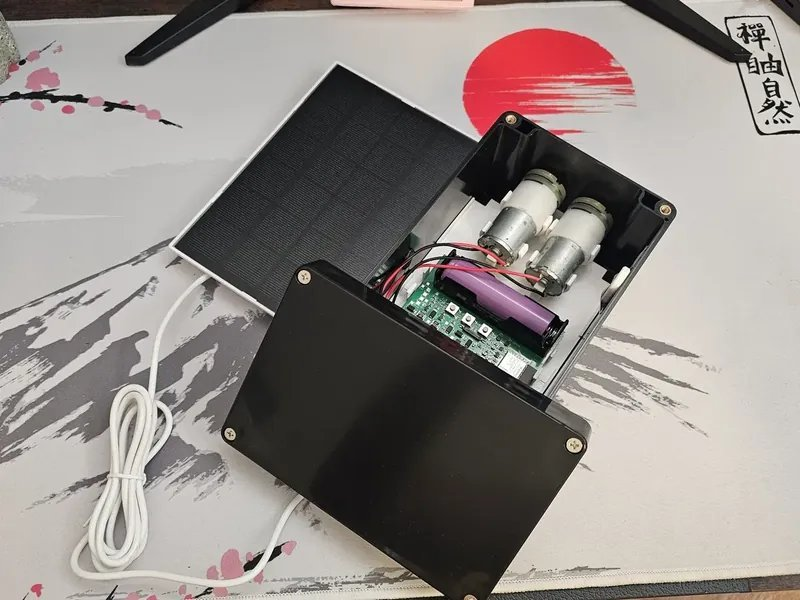
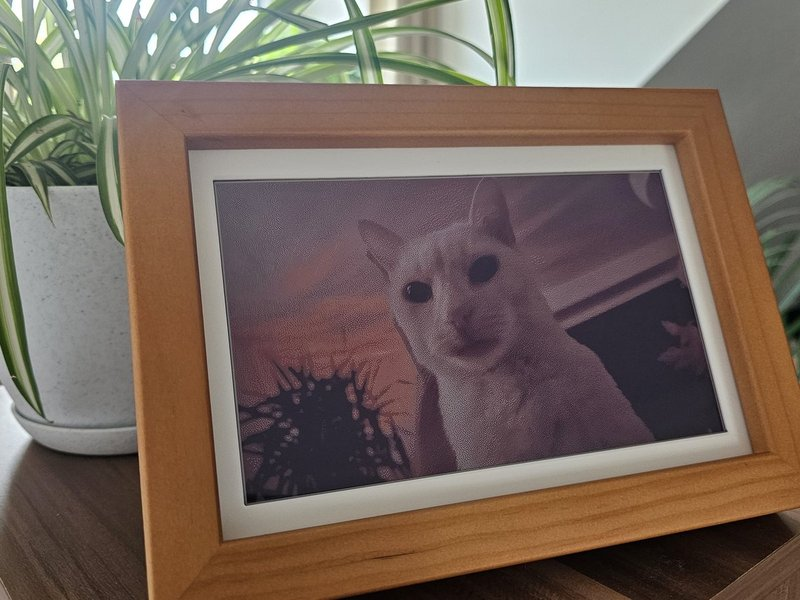

# Can't buy it? Build it.

  
  

**[PlantKeeper](https://plantkeeper.de/go/gh)** is the big one: a solar watering computer that decides on its own when & how much to water. I designed the board, firmware, app & backend.

Right now, on my terrace. Live from the device, refreshed every 10 minutes:

**[photopainter-jpg](https://github.com/VlexWest/photopainter-jpg)** lets the Waveshare PhotoPainter show JPEGs straight from the SD card. Waveshare now links it in their [official docs](https://www.waveshare.com/wiki/PhotoPainter#Related_Document).

**[inky-immich-frame](https://github.com/VlexWest/inky-immich-frame)** turns a Raspberry Pi & an e-ink screen into a photo frame for an Immich album.

More at [thewest.cc](https://thewest.cc)
